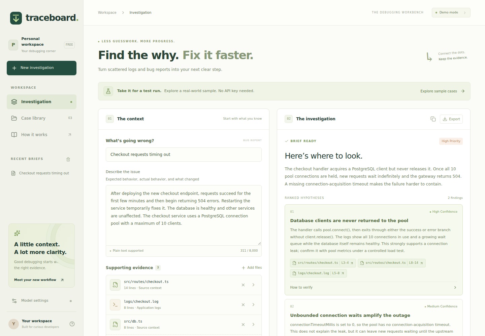
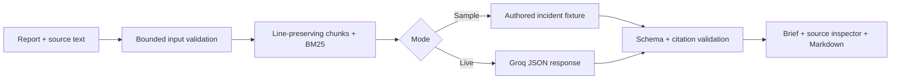

# Traceboard

**Turn a bug report, code, and logs into an inspectable debugging brief.**

Traceboard ranks relevant source passages, produces hypotheses with line-level
citations, and gives you concrete checks to run next. Click a citation to inspect
its original context, then copy or export the investigation as Markdown.

**No-key demo · Optional Groq inference · TypeScript · MIT**



## Try it in two commands

Use **Node.js 22 LTS, at least 22.16**, and npm. With nvm, run `nvm use` first.

```sh
npm ci
npm run dev
```

Open `http://localhost:5173`, keep the preloaded checkout incident, and click
**Investigate issue**. Then inspect a source chip and export the brief.
No API key, account, database, model download, or paid service is needed for this
sample workflow. The app runs locally.

## Does it need a model?

A model is **optional**. The app does not run or train a model on your machine.

| Mode                | What happens                                                                                                                   | Key needed? |
| ------------------- | ------------------------------------------------------------------------------------------------------------------------------ | ----------- |
| Sample, the default | Three authored incident fixtures exercise retrieval, citation validation, history, and export. Results are explicitly labeled. | No          |
| Live, opt-in        | Groq generates a new investigation from your report and retrieved source text. Its output must pass the same citation checks.  | Yes         |

The samples cover a PostgreSQL connection leak, a CORS origin mismatch, and a
React stale closure. Editing a sample requires live mode; it cannot silently
reuse an unrelated canned diagnosis. Provider failures remain visible failures.

To enable live analysis, open **Model settings** and enter a Groq key. It stays
in memory for that tab and is cleared on refresh. Alternatively:

```sh
cp .dev.vars.example .dev.vars
```

Set `GROQ_API_KEY` in `.dev.vars`, restart the server, and select Groq mode.
`GROQ_MODEL` optionally changes the default `openai/gpt-oss-20b` model. Model
access and free quotas vary; consult the [Groq model list](https://console.groq.com/docs/models)
and your [account limits](https://console.groq.com/docs/rate-limits).

## Engineering decisions

- **BM25 retrieval without a vector service.** Source chunks retain original line
  numbers. Exact error names, symbols, and configuration keys are useful signals.
- **Evidence validation.** The server rejects unknown source IDs, fabricated
  quotes, and citations outside the snippets actually supplied to the model.
- **A bounded provider boundary.** Input limits, timeouts, JSON validation,
  sanitized errors, and explicit quota failures keep failures understandable.
- **Browser-local history.** Saved briefs are validated on restore, synchronize
  across tabs, and exclude provider keys. Clear history from the sidebar.
- **A reproducible demo.** Interviews and CI can exercise the complete sample
  workflow without depending on network availability or model quota.

A valid citation establishes that a passage exists, not that a hypothesis is
correct. The app never executes commands or applies fixes. Verify the proposed
checks before changing a system.

## Architecture



Built with React 19, TypeScript, Vinext's Next-compatible App Router, Vite,
Tailwind CSS, and a Cloudflare Worker entrypoint. The domain engine is independent
of the UI and transport. Local development requires no Cloudflare account.

Read the [architecture and tradeoffs](docs/architecture.md),
[evaluation guide](docs/evaluation.md), and [contribution guide](CONTRIBUTING.md).

## Verify

```sh
npm run format:check
npm run check
npm run build
npx playwright install chromium
npm run test:e2e
```

`check` runs lint, TypeScript, deterministic tests, and repository hygiene checks.
Browser tests cover desktop/mobile interactions, citations, exports, history,
and key handling. Neither suite makes a live inference request. GitHub Actions
runs these checks without credentials and exercises the built Worker in its browser suite.

`npm run build` emits the Worker and browser assets under `dist/`.
`npm start` serves that build locally. The checked-in Sites hosting manifest is
optional deployment configuration; it is not a credential and does not require
an account to run the app locally.

## Repository hygiene

The tested [.gitignore](.gitignore) excludes environment files, credentials,
private-key formats, dependencies, builds, local runtime state, logs, archives,
and test reports. The lockfile, screenshots, source, tests, and reviewed empty
environment templates are retained.

```sh
npm run repo:check -- --history
```

This checks publishable files and Git history for recognized credential patterns,
already tracked ignored files, and oversized source files. It never prints token
values. It is not a complete secret scanner; review your staged diff too.
Dependency updates are managed by Dependabot. The two transitive overrides in
`package.json` address the [fflate ZIP64](https://github.com/advisories/GHSA-px8p-9vwx-vf98) and
[minimatch glob-amplification](https://github.com/advisories/GHSA-g3hv-75wg-m249)
advisories; revisit them as upstream packages adopt patched versions.

**Ready to publish?** Follow the [GitHub push instructions and demo walkthrough](docs/github-release.md).
Push from this `traceboard` directory, not its parent workspace.

## Current limits

Custom reports require a working Groq connection. Lexical retrieval can miss
paraphrases and evidence spread across a larger call graph. Live model quality
has not been benchmarked, and no diagnostic-accuracy score is claimed.

Live mode sends your report and selected source text to Groq. Use information
you are permitted to share. Public hosting with a shared server key needs
additional authentication and server-side quotas; see [SECURITY.md](SECURITY.md).

Licensed under [MIT](LICENSE).
