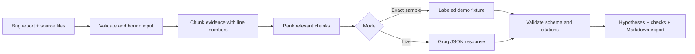

# Traceboard

**Turn a bug report, logs, and code into a debugging brief with source citations.**

Traceboard retrieves relevant lines from the evidence you provide, asks a language model for ranked hypotheses, and validates every citation before showing the result. Each hypothesis includes checks you can run; the output is a starting point for investigation, not proof of a root cause.

Try three sample incidents without an API key, then connect Groq to investigate your own reports.


## What it demonstrates

- **Retrieval:** lexical scoring selects evidence without an embedding service or vector database.
- **Grounded generation:** hypotheses cite named files and line ranges; invalid citations are rejected.
- **A provider boundary:** server-side credentials, bounded inputs, timeouts, explicit provider errors, and validated JSON output.
- **An inspectable workflow:** read the source evidence, follow the proposed checks, and export a Markdown brief.
- **Honest demos:** sample outputs are deterministic fixtures and visibly labeled. Editing a sample requires live inference.

## Run locally

Requires Node.js **22.13 or newer** and npm.

```sh
npm ci
npm run dev
```

Open the Local URL printed by the development server. Load a sample incident and run its analysis in demo mode. No API key, paid account, database, or model download is needed for the samples.

### Enable live analysis

Create a key in the [Groq console](https://console.groq.com/keys), then either enter it in Traceboard's connection settings or configure the local server:

```sh
cp .dev.vars.example .dev.vars
```

Set `GROQ_API_KEY` in `.dev.vars` and restart the development server. A key entered in the app is kept in browser memory for that page session and sent to the app's server for the request; it is not saved to local storage. Server keys remain on the server. Keep both `.dev.vars` and `.env` out of Git.

| Setting        | Purpose                              | Default                |
| -------------- | ------------------------------------ | ---------------------- |
| `GROQ_API_KEY` | Optional server-side Groq credential | Unset; demo mode works |
| `GROQ_MODEL`   | Default model for live requests      | `openai/gpt-oss-20b`   |

Groq model availability and free quotas vary by account and can change. Check [supported models](https://console.groq.com/docs/models) and your [rate limits](https://console.groq.com/docs/rate-limits) before selecting a model. A free quota does not mean unlimited inference. Llama or Mistral access is not assumed.

For hosted Sites, configure these values as runtime secrets through Sites rather than committing a local environment file.

## How it works



The app uses React 19, TypeScript, Vinext's Next-compatible App Router, and Cloudflare Workers. The retrieval and validation engine is independent of the UI and provider transport. No external search or repository access takes place: the model sees only the report and retrieved material you submit.

See [architecture and tradeoffs](docs/architecture.md) for the request flow and [evaluation](docs/evaluation.md) for what the tests establish.

## Verify

```sh
npm run typecheck
npm test
npm run build
```

Tests use Node's built-in test runner and mocked provider requests. GitHub Actions runs the same checks without credentials. A live Groq call requires your own key and is a separate manual check; offline passing tests do not establish model quality.

### Browser checks

```sh
npx playwright install chromium
npm run test:e2e
```

The browser suite starts the local app automatically. It checks sample analysis, source citations, Markdown export, case switching, session-only keys, and the mobile layout. Browser checks make no live provider calls.

## Put it on GitHub

Create an empty repository on GitHub, then run these commands from this directory if it is not already a Git checkout:

```sh
git init
git add .
git commit -m "Build Traceboard debugging workspace"
git branch -M main
git remote add origin https://github.com/YOUR_USERNAME/traceboard.git
git push -u origin main
```

If this checkout already has an `origin`, inspect `git remote -v` and use your preferred remote name instead of adding another `origin`. Sites source synchronization may already maintain its own repository. No GitHub repository is created automatically.

Suggested repository description: **GenAI bug triage with evidence retrieval, validated source citations, Groq inference, and a no-key demo.** Add a screenshot, a short demo recording, and your own explanation of the design tradeoffs before sharing it in applications.

## Limits

Demo mode supports only the supplied unchanged samples. Lexical retrieval may miss relevant evidence phrased differently from the report. Valid citations establish that a quoted passage exists, not that the model's conclusion is correct. The app does not execute fixes or proposed commands.

Source text is sent to Groq only for a live analysis. Review it for secrets and private data first. The hosted Site starts private, but the application does not implement a general public-user authentication, billing, or distributed rate-limiting service. Add those controls before exposing a shared server credential to public traffic.

Licensed under [MIT](LICENSE).
